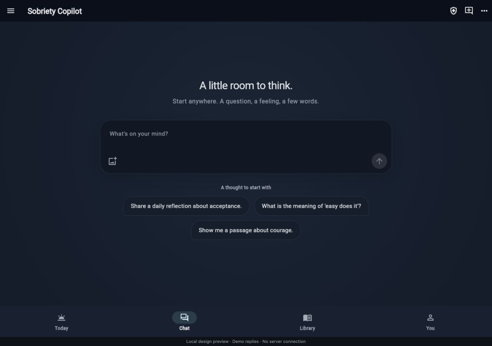
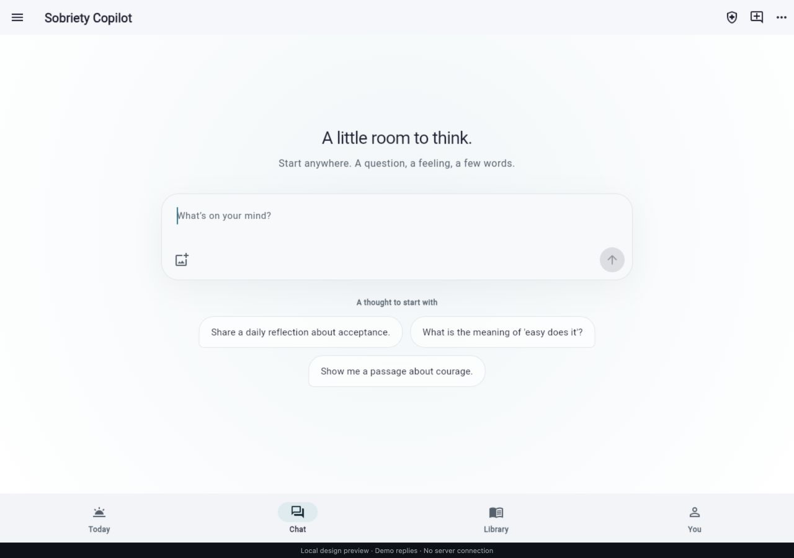
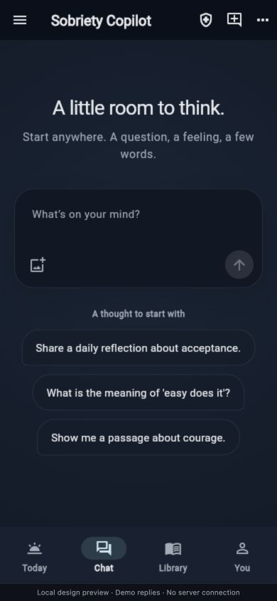
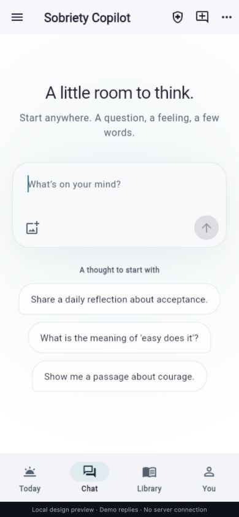

# Quiet first-message chat preview

Implemented on `prototype/day-home`, based on the released `d365a64` baseline. The user approved production web and existing mobile beta rollout on 2026-10-29. Release status is tracked separately; this document describes the design and isolated preview.

## Design

Only the empty Chat view changes. The image, quote, tracker and dense starter stack are replaced by a calm radial color field, a short heading and a centered, wider composer. Attachment and native voice input remain available. Existing explicit resume-thread and memory controls remain below the writing area.

The writing area enters over 650 ms with a small 12 px settle. After 2.4 seconds with an empty composer, three existing public starter prompts appear. Continued idle time grows the desktop set to five, then rotates one choice at a time after seven-second pauses. Small screens stay capped at three. Each replacement fades the old choice fully out before the new one eases in; there are never overlapping outgoing/incoming sets. The composer is anchored independently of question length and count.

A bubble click (or keyboard activation) **submits its question immediately** through the existing send path. A synchronous activation latch and a fresh conversation-state check prevent duplicate queued callbacks; ordinary error handling retains the submitted question in the conversation. Typing immediately hides bubbles and stops additions/rotation. Sending, tab changes, backgrounding and disposal cancel timers/transitions. No controller-change callback submits a second message.

Rotation pauses while any bubble is hovered or keyboard-focused; entering an outgoing bubble cancels that replacement. There is also a keyboard-accessible More ideas control. In screen-reader accessibility mode automatic replacements are suppressed after the initial reveal. Native reduced motion and the browser's live `prefers-reduced-motion` preference remove the fades/movement. A disposable Dart JS-interop adapter supplies the browser preference on this Flutter version.

## Existing graph integration

The implementation reuses `pickStarterPrompts` in `mobile_app/lib/data/starter_prompts.dart`, introduced by commit `1735a4e`. Its bundled `topic_prompts_catalog.dart` is generated by `scripts/build_starter_catalog.py` from the 92-topic taxonomy, 2,557 literature sub-concepts/NPMI layout, and existing curated generation sources. The compiled catalog contains **1,790 catalog prompts across 92 topics**, and **1,839 unique combined prompts** including the existing general/time-of-day pools (counts verified in the Flutter tests).

The existing picker rotates across topics and maintains its 240-prompt recent window. This UI also excludes its bounded 240-item recent history and all currently displayed choices. It does not pass private-memory or personal-interest scores to the picker. This is the existing bundled graph-derived catalog, not a live traversal or fresh query of every production graph node. The local preview uses that same complete bundled question pool, not a small substitute fixture. There is no network/loading delay for suggestions; a picker failure or depleted draw uses existing public fallback content and then stops retries without repeats. Empty fallback content leaves the composer usable with a simple unavailable message.

After the first send, the existing conversation composer and message widgets are byte-for-byte unchanged. No backend, storage schema, permissions or dependency versions changed.

## Review locally

On the Mac: **http://localhost:8770/prototype/**. Select **Chat**, pause without typing, click a bubble to submit it immediately, or type and send your own draft. New conversation replays the entrance. Try light mode via the existing Settings menu.

The preview uses clearly labelled local demo replies, injected only into the temporary build copy. It does not contact the live backend; the preview CSP blocks production connections. The Settings server card therefore shows a connection error, and server-backed library/meeting features are not functional in this isolated demo. Production source continues using the existing real repository.

The loopback server is owned by session-only launchd job `com.codex.sobriety-chat-canvas-preview`. It survives closing this task/shell and runs until logout/reboot or an explicit stop. No login item is installed. The previous preview on 8769 is untouched.

```sh
bash scripts/preview_chat_canvas.sh --status
bash scripts/preview_chat_canvas.sh --stop
bash scripts/preview_chat_canvas.sh --background
```

Artifacts and logs live in `~/Library/Caches/com.codex.sobriety-chat-canvas-preview/`.

## Verification

- Flutter analysis: no issues in changed production code and new tests.
- Full Flutter suite: **291 tests passed**.
- Focused tests cover exactly-once tap/keyboard submission, existing error handling, bounded responsive rotation, no repeats in the test pool, stationary composer, focus/hover protection, mid-fade viewport changes, typing cancellation, lifecycle/disposal, reduced motion, manual screen-reader refresh, fallback behavior, verified catalog counts, large text and accessible controls.
- Existing saved-conversation, memory/resume and draft-preserving navigation tests pass.
- Release web build passed in an isolated local temporary directory.
- Chrome visual checks: 1280×900 desktop and 390×844 mobile; light/dark; entry fade followed by idle prompts; draft dismissal; tab switching; immediate bubble submission; Enter-to-send; streamed local fixture reply; New conversation; live browser reduced-motion changes. Browser test overrides were confined to the preview tab, which closed during an extension session reset; final preview was reopened at normal settings.
- Final preview listener verified on `127.0.0.1:8770`, and the exact URL opened successfully again in a fresh browser tab.
- Native physical-device/soft-keyboard testing is still a release-stage check; this task built and inspected the web prototype and exercised constrained layouts with Flutter widget tests.

## Screenshots





